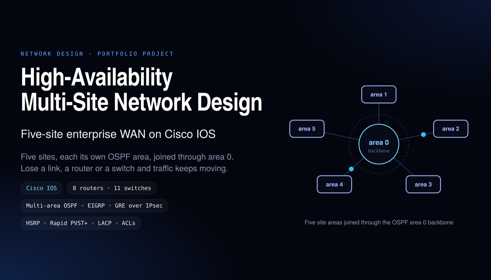

# High-Availability Multi-Site Network Lab



A Cisco Packet Tracer academic project covering five locations: Boston, Mumbai, New York, London, and Germany. The design uses eight routers and eleven switches to practice addressing, routing, segmentation, and redundancy.

## Implemented and documented topics

- Department VLANs, trunking, IP subnetting, and DHCP.
- Multi-area OSPF and an EIGRP lab configuration.
- HSRP gateway redundancy with priority, preemption, and 2-second hello / 6-second hold timers.
- Rapid PVST+, PortFast, BPDU Guard, and LACP EtherChannel.
- ACLs and switch port security.
- GRE tunneling between the Boston and Mumbai headquarters.
- Routing, VLAN, and connectivity checks documented in the project report.

## Open the lab

```bash
git clone https://github.com/Jeevanandh32/Multi-Location-Network-Design-and-Implementation-using-Cisco-Packet-Tracer.git
cd Multi-Location-Network-Design-and-Implementation-using-Cisco-Packet-Tracer
```

Open `MULTI-LOCATION NETWORK DESIGN.pkt` in Cisco Packet Tracer. Review the report alongside the topology for device configuration and verification screenshots.

## Files

- [Packet Tracer topology](MULTI-LOCATION%20NETWORK%20DESIGN.pkt)
- [Original academic report](TELE5330_002313120_Ravi_Jeevanandh_Project%202.pdf)

## Verification scope and report clarification

- This is a simulated academic network, not a production deployment.
- The report's page 40 describes the GRE tunnel as encrypted, but the included configuration demonstrates GRE only. It does not establish IPsec protection. The project summary therefore claims GRE tunneling; a GRE-over-IPsec claim needs the corresponding crypto configuration and security-association verification.
- HSRP timer settings and redundancy configuration are not measured convergence times. No sub-50-ms failover or zero-packet-loss guarantee is established by the committed evidence.
- The PDF remains the original course submission. These clarifications apply when using its contents in a portfolio or resume.
